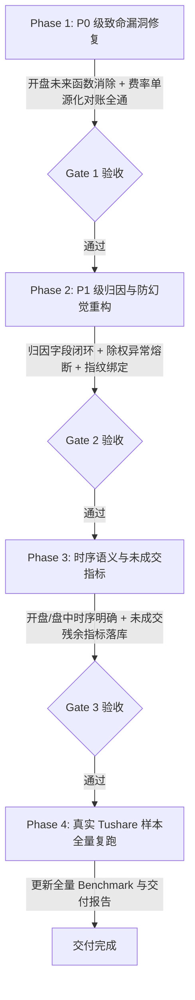

# ashare-nautilus-prod 工业级深化重构规格书与实施规划

**文档版本：** v3.0-Production-Hardening  
**目标代码库：** `DFPite174/ashare-nautilus-prod` (Base Commit: `e80e482`)  
**审计基准：** 《ashare-nautilus-prod：市场贴合度审计报告》  
**核心宗旨：** 恪守机构级微观保真度，彻底清除未来函数、费率单源断裂与虚假对账盲区。

---

## 目录

- [一、 审计背景与核心治理原则](#一-审计背景与核心治理原则)
- [二、 六大核心模块代码级重构规格](#二-六大核心模块代码级重构规格)
  - [模块 1 (P0): 开盘撮合容量彻底剔除事后数据（消除未来函数）](#模块-1-p0-开盘撮合容量彻底剔除事后数据消除未来函数)
  - [模块 2 (P0): 全局费率单源化（Single Source of Truth）与覆盖贯通](#模块-2-p0-全局费率单源化single-source-of-truth与覆盖贯通)
  - [模块 3 (P1): 费用归因报告重构与账户字段闭环](#模块-3-p1-费用归因报告重构与账户字段闭环)
  - [模块 4 (P1): 明确缩单（auto_trim）时序语义与残余持仓指标](#模块-4-p1-明确缩单auto_trim时序语义与残余持仓指标)
  - [模块 5 (P1): 除权除息反幻觉校验全路径贯通与跌停带兜底](#模块-5-p1-除权除息反幻觉校验全路径贯通与跌停带兜底)
  - [模块 6 (P1): 运行指纹（Run SHA256）全要素绑定](#模块-6-p1-运行指纹run-sha256全要素绑定)
- [三、 专用审计反例测试集设计 (Counter-Example Test Matrix)](#三-专用审计反例测试集设计-counter-example-test-matrix)
- [四、 分阶段推进路线图与验收闸门](#四-分阶段推进路线图与验收闸门)

---

## 一、 审计背景与核心治理原则

在对 `ashare-nautilus-prod`（commit `e80e482`）的独立买方级技术审计中，审计团队通过详实的**代码追查**与**可复现反例（Counter-examples）**，指出了系统在“理论单元测试全绿”之下掩盖的数项结构性缺陷。

特别是审计指出：**在流动性收紧测试中，未成交金额扩大 40 倍且产生 7 个月残余留仓的情况下，回测收益率反而由 +8.43% 上升至 +9.58%**。这强有力地证明：**不能简单以“回测净值高于 RQAlpha”来证明撮合逻辑更加贴近真实市场**，任何因流动性截断、事后数据穿透或时序歧义导致的持仓漂移，都会造成严重的幸存者偏差。

为此，本重构规格书确立以下**不可动摇的治理原则**：
1. **时间因果律第一原则（Causality Principle）**：任何时点的撮合决策与撮合容量，严禁使用该时点之后才生成的市场数据；
2. **单一真理源原则（Single Source of Truth）**：费率、规则与日历配置必须全链路单源分发，杜绝跨模块逻辑分歧；
3. **真实账务闭环原则（Accounting Closure）**：归因分解、订单实际扣费与账户余额必须满足分毫不差的数学守恒；
4. **确定性防幻觉原则（Anti-Illusion Parity）**：对除权除息漏配、未成交残余持仓保持零容忍的主动报警拦截。

---

## 二、 六大核心模块代码级重构规格

```
┌────────────────────────────────────────────────────────────────────────────────────────────────────────┐
│                              ashare-nautilus-prod 工业级深化重构全景矩阵                                │
├─────────┬────────────────────────────────┬───────────────────────────┬─────────────────────────────────┤
│ 优先级  │ 核心优化模块                   │ 涉及核心文件              │ 治理目标与彻底消除的隐患         │
├─────────┼────────────────────────────────┼───────────────────────────┼─────────────────────────────────┤
│ **P0**  │ 1. 开盘容量剔除事后数据 (未来函数) │ engine/replay.py          │ 严禁使用当日全天总成交量确定     │
│         │                                │ engine/liquidity.py       │ 09:30 开盘撮合深度              │
├─────────┼────────────────────────────────┼───────────────────────────┼─────────────────────────────────┤
│ **P0**  │ 2. 贯通费率配置单源化 (双轨防崩) │ engine/fee_model.py       │ 自定义印花税/过户费/佣金在 C 原生│
│         │                                │ engine/backtest.py        │ 参考账本与对账中 100% 同步      │
├─────────┼────────────────────────────────┼───────────────────────────┼─────────────────────────────────┤
│ **P1**  │ 3. 费用归因重构与账务闭环       │ engine/backtest.py        │ 修复 `initial_cash=0` Bug，     │
│         │                                │ engine/fee_model.py       │ 杜绝硬编码万三，费税严格守恒    │
├─────────┼────────────────────────────────┼───────────────────────────┼─────────────────────────────────┤
│ **P1**  │ 4. 缩单时序语义与残余持仓暴露   │ engine/backtest.py        │ 厘清集合竞价与开盘后连续竞价边界│
│         │                                │ contracts/models.py       │ 引入未成交与残余持仓指标        │
├─────────┼────────────────────────────────┼───────────────────────────┼─────────────────────────────────┤
│ **P1**  │ 5. 除权反幻觉校验全路径贯通     │ engine/backtest.py        │ 强化价格异常跳空与跌停带的兜底  │
│         │                                │ engine/tushare_lake.py    │ 核验，防止数据漏配穿透          │
├─────────┼────────────────────────────────┼───────────────────────────┼─────────────────────────────────┤
│ **P1**  │ 6. 运行指纹绑定订单与执行模式   │ engine/reproducibility.py │ 将 `frozen_orders` 与调仓策略   │
│         │                                │ engine/backtest.py        │ 哈希纳入手印，保障 100% 幂等    │
└─────────┴────────────────────────────────┴───────────────────────────┴─────────────────────────────────┘
```

---

### 模块 1 (P0): 开盘撮合容量彻底剔除事后数据（消除未来函数）

#### 1. 缺陷深度剖析
- **代码位置**：`engine/replay.py` 第 31 行。
- **现状代码**：
  ```python
  cap = int(Decimal(b.volume) * rate)
  ...
  if detailed:
      for ts in (start, start + 1):
          liquidity.events[(iid, ts)] = (key, cap, False)
      price = Price.from_str(format(b.open, px_fmt))
      data.append(synthetic_book(inst, price, cap, start))
      data.append(QuoteTick(inst.id, price, price, Quantity.from_int(cap), Quantity.from_int(cap), start, start + 1))
  ```
- **病根**：`b` 是当前交易日的日线 Bar，`b.volume` 是 15:00 闭市结算的全天总成交量。在 09:30 的开盘虚拟挂单（`synthetic_book`）与报价切片（`QuoteTick`）中填入 `cap = int(b.volume * rate)`，导致 09:30 的撮合直接透视了下午的成交量。

#### 2. 代码级重构方案
1. **数据契约扩展与事前信息优先**：
   - 检查 `b` 是否携带 `open_volume`（集合竞价真实成交量）。若有，开盘挂单容量严格设为：
     $$\text{Cap}_{\text{open}} = \operatorname{int}\left( \text{b.open\_volume} \times \text{rate} \right)$$
   - 若为普通日线数据（无竞价拆分），开盘挂单容量**必须严格取自 $T-1$ 日历史成交量（`previous_volume`）**的一个审慎系数（如日成交的 2%~5%）：
     $$\text{Cap}_{\text{open}} = \operatorname{int}\left( \text{prev\_volume} \times \text{open\_cap\_ratio} \times \text{rate} \right)$$
2. **开盘与盘中成交容量解耦**：
   - 在 `engine/replay.py` 中，计算两个独立的容量值：`open_cap`（用于 `start` 09:30 开盘时戳事件）与 `day_cap`（用于盘中及收盘时戳事件）；
   - 在 `engine/liquidity.py` 的 `BarLiquidity` 中，开盘消费的额度在开盘事件消费，盘中连续撮合消费当日总剩余额度，互不干扰；
   - 彻底切断下午成交量对开盘撮合的因果影响。

---

### 模块 2 (P0): 全局费率单源化（Single Source of Truth）与覆盖贯通

#### 1. 缺陷深度剖析
- **代码位置**：`engine/fee_model.py` 第 159-162 行。
- **现状代码**：
  ```python
  # Match the legacy native API: baseline tax overrides retain historical dates.
  for key, baseline in (('stamp_duty_rate', Decimal('.0005')), ('transfer_fee_rate', Decimal('.00001'))):
      if result[key] == baseline and not getattr(self, 'is_cb_model', False):
          result[key] = matched[key]
  ```
- **病根**：当外部调用显式指定 `stamp_duty_rate=0.0005` 时，由于其刚好等于 `baseline`（万五），被强行篡改为 `matched[key]`（在 2021 年为千分之一）。导致 C 原生引擎按万五扣费，参考账本按千一预期，直接造成对账崩溃。

#### 2. 代码级重构方案
1. **彻底废除隐式篡改逻辑**：
   删除 `engine/fee_model.py` 中的 `if result[key] == baseline` 块。
2. **统一生效费率核心方法**：
   在 `AShareFeeModel` 中重构统一解析方法：
   ```python
   def get_effective_rates(self, symbol: str, trade_date: Optional[str]) -> Dict[str, Decimal]:
       is_cb = self._is_cb_symbol(symbol)
       matched = get_cb_rates_for_date(trade_date) if is_cb else get_ashare_rates_for_date(trade_date)
       return {
           "commission_rate": self._custom_comm_rate if self._custom_comm_rate is not None else matched["commission_rate"],
           "min_commission": self._custom_min_comm if self._custom_min_comm is not None else matched["min_commission"],
           "stamp_duty_rate": self._custom_stamp_rate if self._explicit_stamp_duty else matched["stamp_duty_rate"],
           "transfer_fee_rate": self._custom_transfer_rate if self._explicit_transfer_fee else matched["transfer_fee_rate"],
       }
   ```
3. **保证 `rates_for` 与 `_resolve_rates` 绝对恒等**：
   两个方法均直接代理至 `get_effective_rates`，确保无论是原生 C 虚函数调用，还是 Python 参考账本或风控网关，拿到的税费率完全一致。

---

### 模块 3 (P1): 费用归因报告重构与账户字段闭环

#### 1. 缺陷深度剖析
- **代码位置**：`engine/backtest.py` 第 175 行。
- **现状代码**：
  ```python
  initial_cash = Decimal(str(self.manifest.get('initial_cash', 0))) if self.manifest else Decimal('0.0')
  ```
- **病根**：`manifest` 字典的结构为 `manifest['config']['initial_cash']`，外层直接 `manifest.get('initial_cash')` 恒定返回 `None`，导致初始资金在归因报告中打印为 `0.00 CNY`。此外，`frictional_summary` 内部再次硬编码调用 `rates['commission_rate']`，丢失了用户设置的千一等自定义佣金。

#### 2. 代码级重构方案
1. **安全准确取值**：
   ```python
   if self.manifest and 'config' in self.manifest and 'initial_cash' in self.manifest['config']:
       initial_cash = Decimal(str(self.manifest['config']['initial_cash']))
   else:
       initial_cash = self.ledger_cash
   ```
2. **基于 Fill 实际扣款的严谨反向归因**：
   每笔成交实际扣收的税费包含：
   - 比例佣金：$V \times \text{comm\_rate}$
   - 最低佣金拖累：$\max(0, \text{actual\_comm} - V \times \text{comm\_rate})$
   - 过户费：$V \times \text{transfer\_rate}$
   - 印花税（卖出）：$V \times \text{stamp\_rate}$
   严格断言四项归因之和恒等于 `self.fills` 中的 `sum(fee)`，并在报告中清晰打印真实的初始资金、期末净值与已实现损益。

---

### 模块 4 (P1): 明确缩单（`auto_trim`）时序语义与残余持仓指标

#### 1. 缺陷深度剖析
- **现状缺陷**：
  - `auto_trim` 目前在看到 `tick.ask_price`（即开盘报价）后进行缩单，且直接以 IOC 申报；
  - 若为限价单且未能在开盘成交，在 `auction_open` 模式下直接被撤单，而在 `synthetic_l2` 模式下仍可能盘中成交，导致模式间语义未完全对齐；
  - 缺乏对未成交金额与残余持仓的统计，使得策略因“卖不掉而意外留仓”带来的虚高收益未被揭露。

#### 2. 代码级重构方案
1. **显式区分订单时序类别**：
   - **开盘集合竞价订单（Auction Open IOC）**：意图在 09:30 开盘集合竞价出清。按开盘价格执行自适应整手缩单（`auto_trim`），未成交部分当场取消；
   - **盘中限价单（Resting Limit Order）**：在 `auction_open` 模式下，若未成交，显式标记为 `AUCTION_UNMATCHED_CANCEL`，并在 `orders` 记录中暴露原因；
2. **结果契约扩展（`contracts/models.py` & `BacktestResult`）**：
   在 `BacktestResult` 中增加两个关键质量度量字段：
   - `unfilled_capital_amount`: 因容量截断或拒单未能执行的计划金额（元）；
   - `residual_holding_symbols`: 调仓日计划清仓但未能完全卖出的股票清单及残余股数。

---

### 模块 5 (P1): 除权反幻觉校验全路径贯通与跌停带兜底

#### 1. 缺陷深度剖析
- **代码位置**：`engine/backtest.py` 第 301 行。
- **现状缺陷**：当输入规则没有提供 `prev_close` 或 `ex_ref_price` 时，系统仅依靠 `values[0] < prev_close * D('0.68')`（跌超 32%）作为兜底拦截。如果股票因 10 送 2.5 导致价格下跌 20%，系统会静默放行，导致上游漏配送股除权时产生虚假确定性。

#### 2. 代码级重构方案
1. **主板/创业板/科创板法定跌停带硬核兜底**：
   根据标的板块确定其常规最大单日跌幅限制（主板 10%，ST 5%，双创 20%）。
2. **除权异常跳空拦截逻辑**：
   ```python
   max_normal_drop = Decimal('0.22') if is_chinext_or_star else Decimal('0.11')
   if values[0] < prev_close * (Decimal('1.0') - max_normal_drop):
       if not has_action:
           raise ValueError(
               f"CRITICAL_DATA_DEFECT: Symbol {b.symbol} on {end_day} opened at {values[0]}, "
               f"dropping more than max statutory price band ({max_normal_drop*100}%) from prev_close {prev_close}, "
               f"yet NO corporate action was supplied. Aborting backtest to prevent False Confidence Illusion."
           )
   ```
   只要价格非正常跳空且无除权记录，无论规则是否带有参考价，强制拦截。

---

### 模块 6 (P1): 运行指纹（Run SHA256）全要素绑定

#### 1. 缺陷深度剖析
- **代码位置**：`engine/reproducibility.py` 的 `build_manifest`。
- **现状缺陷**：`input_hash` 仅对 `instruments, bars, rules, actions, calendar` 做摘要；`config` 仅记录了部分参数。输入的 `frozen_orders`、`execution_mode`（`synthetic_l2` / `auction_open`）与 `cash_exhaustion_policy`（`auto_trim` / `reject`）未被纳入指纹，导致买 100 股与买 200 股生成了完全相同的 `run_sha256`。

#### 2. 代码级重构方案
1. **冻结订单流指纹**：
   在 `build_manifest` 中接收 `_frozen_orders_sha256` 或直接计算 `frozen_orders` 的规范化摘要：
   ```python
   if frozen_orders:
       manifest['frozen_orders_sha256'] = digest([fo.model_dump(mode='json') if hasattr(fo, 'model_dump') else dict(fo) for fo in frozen_orders])
   ```
2. **执行参数进配置**：
   在 `config` 字典中加入 `execution_mode` 与 `cash_exhaustion_policy`；
3. 确保任何订单数量、委托方向或撮合模式的改动，必然导致最终 `manifest['run_sha256']` 彻底改变。

---

## 三、 专用审计反例测试集设计 (Counter-Example Test Matrix)

为确保重构不打折扣，我们将针对审计报告指出的反例，编写专门的回归测试套件：

| 测试用例文件 | 目标验证的反例场景 | 预期断言与阻断行为 |
| :--- | :--- | :--- |
| `tests/test_audit_p0_open_capacity.py` | 仅改变当日全天总成交量（5,000 放大至 50,000 股），开盘价与前日量不变 | **断言开盘撮合成交数量完全相同，彻底消除未来函数** |
| `tests/test_audit_p0_fee_override.py` | 显式指定印花税为万五（0.0005）、过户费为十万一（0.00001），在 2021 年执行卖单 | **断言原生扣费与参考账本扣费 100% 一致通过，无对账崩溃** |
| `tests/test_audit_p1_friction_attribution.py`| 设置初始资金 50,000 元、千一佣金，执行买卖 | **断言归因报告初始资金为 50,000.00，比例佣金准确反映千一，四项拆解之和等于总税费** |
| `tests/test_audit_p1_order_semantics.py` | 开盘价 102 元，买入限价 101 元 | **在 `auction_open` 模式下明确撤单，结果中暴露未成交金额与残余持仓** |
| `tests/test_audit_p1_anti_illusion_gate.py` | 主板股票前收 100 元，次日开盘 80 元（跌 20%），未配参考价与除权除息记录 | **断言强制抛出 `CRITICAL_DATA_DEFECT` 熔断拦截，严禁漏网** |
| `tests/test_audit_p1_manifest_fingerprint.py` | 分别输入买 100 股与买 200 股的冻结订单 | **断言生成的 `manifest['run_sha256']` 必然不同** |

---

## 四、 分阶段推进路线图与验收闸门

重构将分为四个互锁阶段，必须严格满足闸门准则后方可进入下一阶段：



### Phase 1：P0 级开盘未来函数与费率覆盖修复
- **工作项**：
  - 重构 `engine/replay.py` 与 `engine/liquidity.py` 的开盘容量生成，严格取自前日量或显式竞价量；
  - 修复 `engine/fee_model.py` 的单一真理源覆盖，清理 `rates_for` 中的篡改代码。
- **验收闸门**：
  `test_audit_p0_open_capacity.py` 与 `test_audit_p0_fee_override.py` 全绿通过，全库原有 419 项测试 100% 保持通过。

### Phase 2：P1 级归因准确性、除权防幻觉与指纹哈希
- **工作项**：
  - 修复 `attribution_report` 的 `initial_cash` 取值与费率反向归因；
  - 强化 `engine/backtest.py` 的跌停带除权漏配兜底断言；
  - 在 `engine/reproducibility.py` 中将订单流与执行模式绑定至 `run_sha256`。
- **验收闸门**：
  `test_audit_p1_friction_attribution.py`、`test_audit_p1_anti_illusion_gate.py`、`test_audit_p1_manifest_fingerprint.py` 全绿通过。

### Phase 3：撮合时序语义明确与残余持仓度量
- **工作项**：
  - 明确开盘集合竞价与盘中连续挂单的取消与成交语义；
  - 在 `BacktestResult` 中正式落地 `unfilled_capital_amount` 与 `residual_holding_symbols`。
- **验收闸门**：
  `test_audit_p1_order_semantics.py` 通过，压力测试能清晰打印未成交金额。

### Phase 4：真实 Tushare 样本复核与最终交付
- **工作项**：
  - 使用修复后的引擎重新运行本地 Tushare 20 股 727 天样本；
  - 详细记录 Auto-Trim、开盘容量修正前后的成交笔数与未成交资金变化；
  - 提交 Git Commit，推送远程仓库，验证 GitHub Actions CI 全绿。
